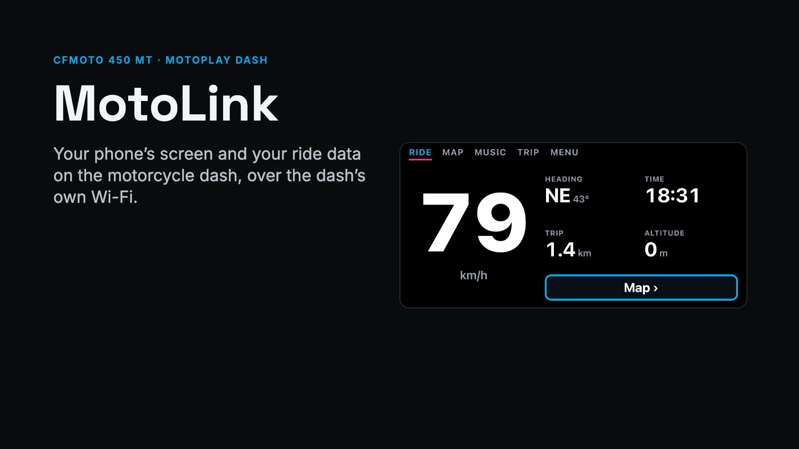
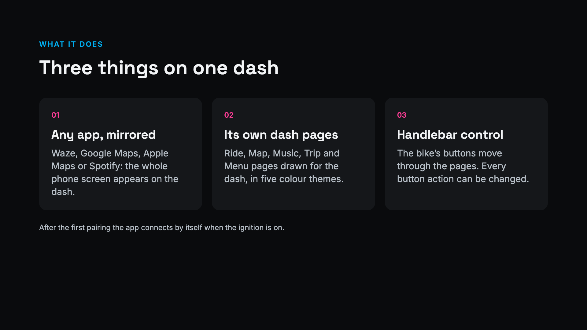
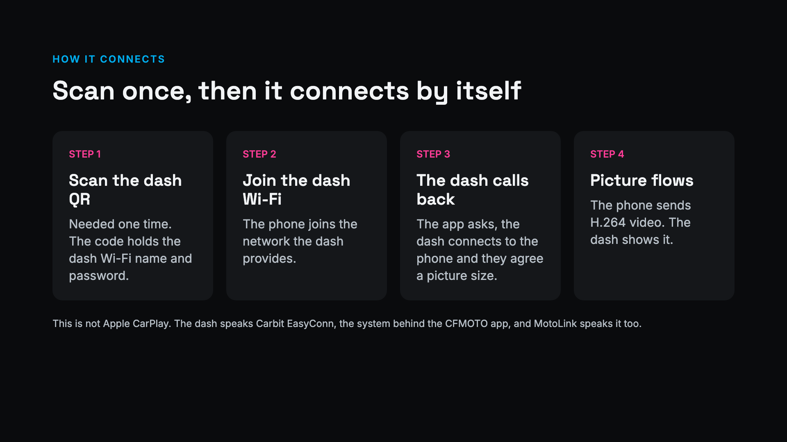
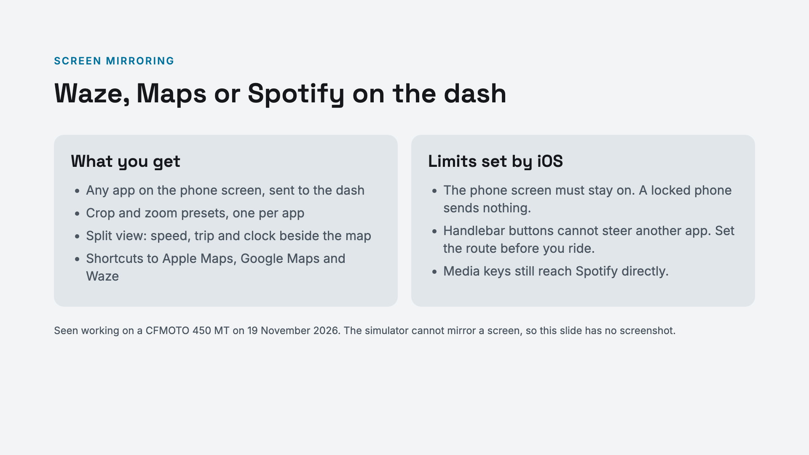
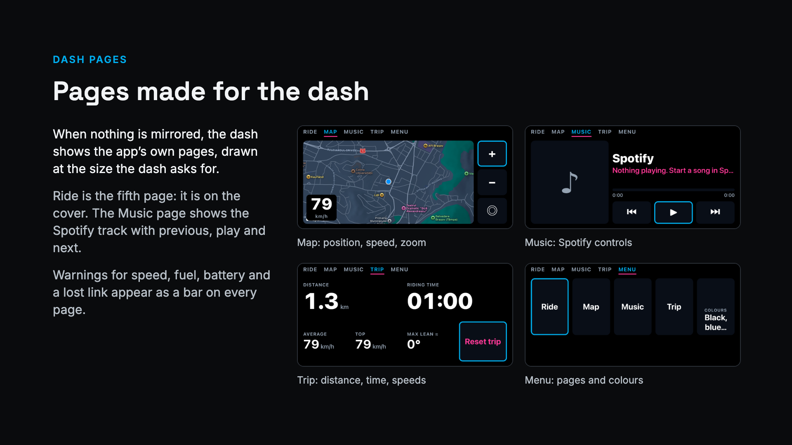
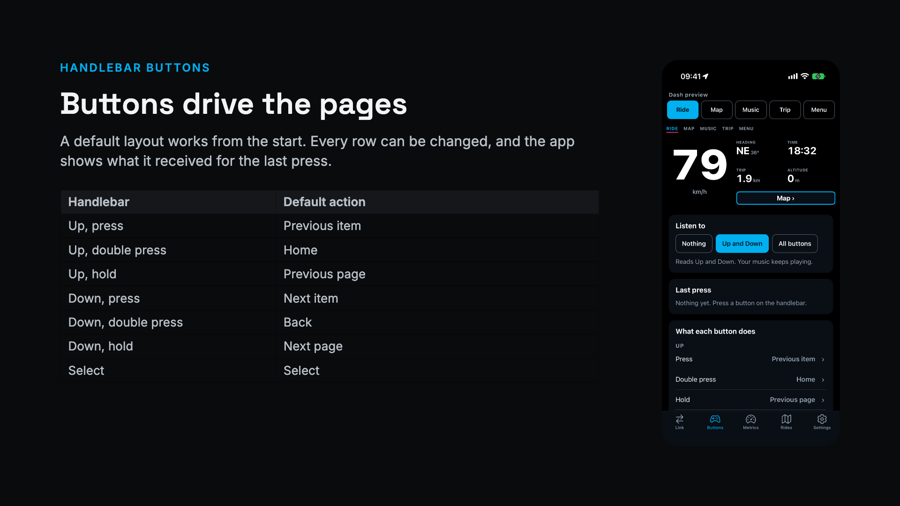
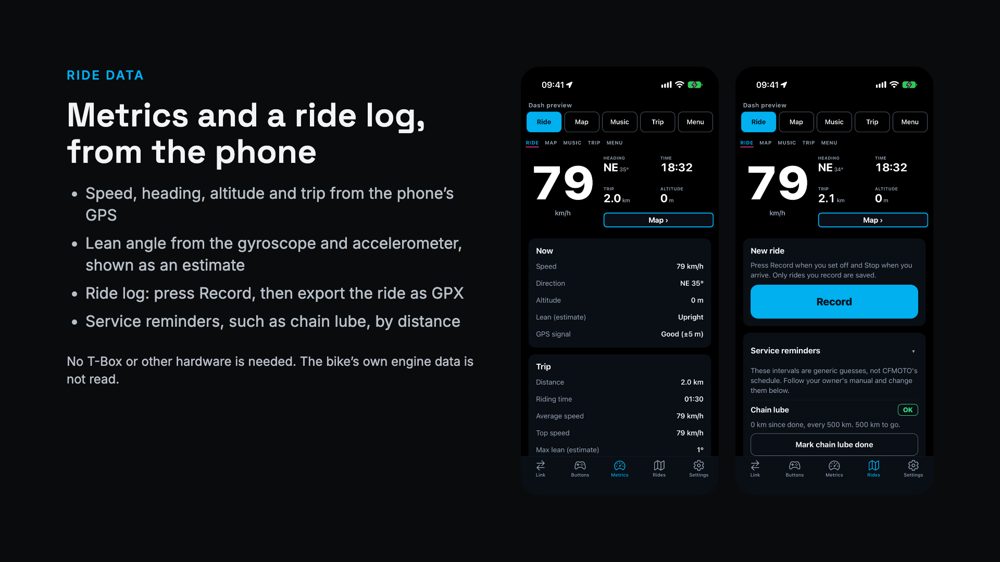
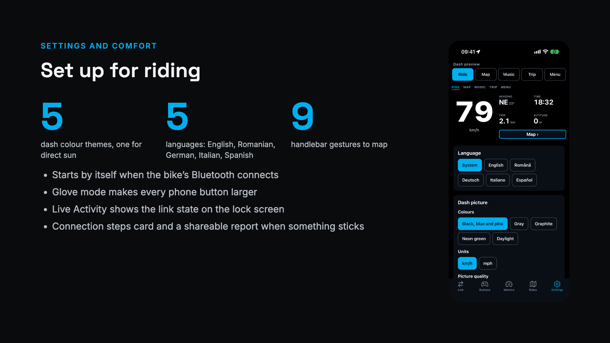
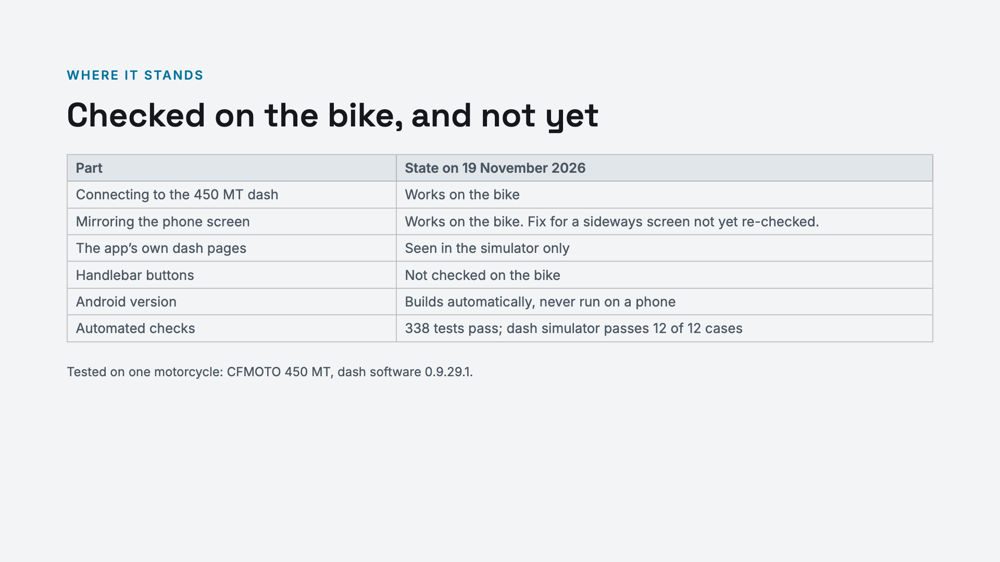
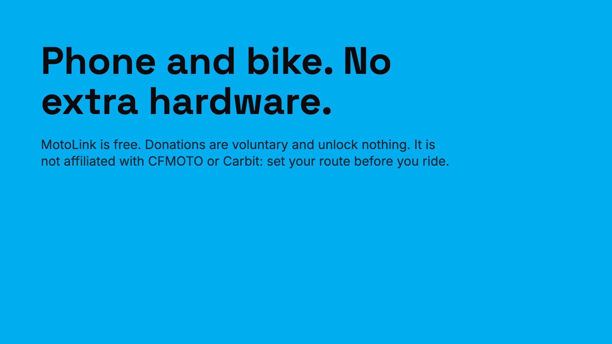

# MotoLink for CFMOTO

Repository: [iamandiradu/motolink-cfmoto](https://github.com/iamandiradu/motolink-cfmoto) · [Releases](https://github.com/iamandiradu/motolink-cfmoto/releases)

MotoLink is an iPhone app for the CFMOTO 450 MT dash (MotoPlay). It streams a picture to the dash over the dash's Wi-Fi: either the phone screen (Waze, Google Maps, Spotify), or its own ride data, map and trip computer driven by the handlebar buttons.

This is not Apple CarPlay. The dash speaks Carbit EasyConn, not CarPlay, and iOS only projects CarPlay to Apple-certified receivers. See [docs/PLAN.md](docs/PLAN.md) for what was learned from the reference projects, the architecture and the open risks.

**Status: connects and mirrors on a CFMOTO 450 MT** (dash software 0.9.29.1, model id 37416), first tested on 2026-11-19. Handlebar buttons, the app's own dash pages and Android have not been checked on a bike yet.

## Overview

The pictures of the app and of the dash pages come from the iOS Simulator, not from a motorcycle.





















## Using it

1. Close the official CFMOTO app. It uses the same ports, and the dash would talk to it instead.
2. Pair the phone with the bike in iOS Bluetooth settings. Buttons arrive over Bluetooth.
3. Ignition on, open MotoPlay on the dash, go to the phone connection screen. The dash shows a QR code.
4. In MotoLink tap **Scan the dash QR**. This is needed once.
5. Keep the app open on screen while riding.

Next time: ignition on, open the app. It connects by itself.

## Apple Maps, Google Maps, Waze or Spotify on the dash

The app can mirror the whole phone screen to the dash, so any app shows up there.

1. Connect to the bike as above.
2. On the **Link** tab tap **Start mirroring**, choose MotoLink, then **Start Broadcast**.
3. Open the app you want (the card has shortcuts to Apple Maps, Google Maps and Waze) and turn the phone sideways. A sideways screen fills the dash; an upright one is shown between black bars.

Limits, all from iOS:

- The phone screen has to stay on. A locked phone shows nothing. Waze keeps the screen awake while it navigates.
- The handlebar buttons cannot steer another app. Set the route before riding. Media keys still reach Spotify directly.
- In the Buttons tab use **Off** or **Up / down only**. **All buttons** pauses other music.

To stop, tap **Stop mirroring**, or the red indicator at the top of the phone screen.

## Spotify on the dash

The dash has a **Music** page: cover, title, artist, progress, and previous / play / next that the handlebar buttons can reach. Handlebar gestures can also be mapped straight to Spotify play, next and previous in the Buttons tab.

iOS lets no app see what another app is playing, so the page asks Spotify's servers. Set it up once in **Settings → Spotify on the dash**:

1. At developer.spotify.com create an app. Redirect URI: `motolink://spotify`. Tick Web API.
2. Paste its Client ID into the app and tap **Connect Spotify**.

It needs mobile data while riding, and the controls need Spotify Premium. YouTube Music has no such interface; mirror its screen instead.

## Colours

The dash picture has five themes: black with blue and pink, gray, graphite, neon green, and a light one for daylight. Choose in Settings, or from the Menu page on the dash.

## Buttons

| Handlebar | Default action |
| --- | --- |
| Up, press | Previous item |
| Up, double press | Home |
| Up, hold | Previous page |
| Down, press | Next item |
| Down, double press | Back |
| Down, hold | Next page |
| Select | Select |

Every row can be changed in the **Buttons** tab, which also shows what the phone received for the last press. Which of these the 450 MT actually sends is not documented anywhere yet; that screen is how to find out.

## Development

```bash
git clone https://github.com/iamandiradu/motolink-cfmoto.git
```

```bash
cd motolink-cfmoto
```

```bash
npm install
```

```bash
npm test
```

```bash
npm run typecheck
```

The app has a native module, so it does not run in Expo Go. With Xcode installed:

```bash
npx expo run:ios --device
```

The `ios/` folder is generated by `expo prebuild` and is not committed. Native code lives in [modules/moto-link/ios](modules/moto-link/ios).

## Builds

Every merge to `master` runs [.github/workflows/build-ipa.yml](.github/workflows/build-ipa.yml): tests, then an `.ipa` attached to a [GitHub release](https://github.com/iamandiradu/motolink-cfmoto/releases) and to the workflow run.

By default the `.ipa` is **unsigned**. Install it with a tool that signs with your Apple ID, such as AltStore or Sideloadly.

To get a signed `.ipa` from CI, add four repository secrets:

| Secret | Content |
| --- | --- |
| `IOS_CERTIFICATE_P12_BASE64` | base64 of your signing certificate `.p12` |
| `IOS_CERTIFICATE_PASSWORD` | password of that `.p12` |
| `IOS_PROVISIONING_PROFILE_BASE64` | base64 of a provisioning profile for `com.iamandiradu.motolink` |
| `IOS_BROADCAST_PROFILE_BASE64` | base64 of a provisioning profile for `com.iamandiradu.motolink.broadcast` |

Both the app and the screen-mirroring extension are signed ([scripts/sign-ipa.sh](scripts/sign-ipa.sh)). The profiles must list your iPhone. This needs a paid Apple Developer account: profiles from a free Apple ID last 7 days, which makes a CI build pointless.

A profile from a paid Apple Developer account can include the Hotspot Configuration capability, which lets the app join the dash Wi-Fi by itself. Without it, join the dash Wi-Fi once in iOS Settings; iOS remembers the network.

## Supporting the project

MotoLink is free. Donations are voluntary and unlock nothing; see [docs/DONATIONS.md](docs/DONATIONS.md) for how the in-app Support card is set up.

## Languages

English, Romanian, German, Italian and Spanish. The app follows the phone's language; change it in Settings.

## Credits

The dash protocol was documented by the OpenCfMoto projects: [dcoletto/open-cfmoto](https://github.com/dcoletto/open-cfmoto), [zanderp/open-cfmoto](https://github.com/zanderp/open-cfmoto), [andpower/open-cfmoto-450nk](https://github.com/andpower/open-cfmoto-450nk), [keriman/k1_open-cfmoto](https://github.com/keriman/k1_open-cfmoto) and [ionutradu252/open-cflink](https://github.com/ionutradu252/open-cflink). MotoLink is a separate implementation and contains no code from them.

Not affiliated with CFMOTO or Carbit. Set your route before you ride, and do not rely on this for anything critical.
